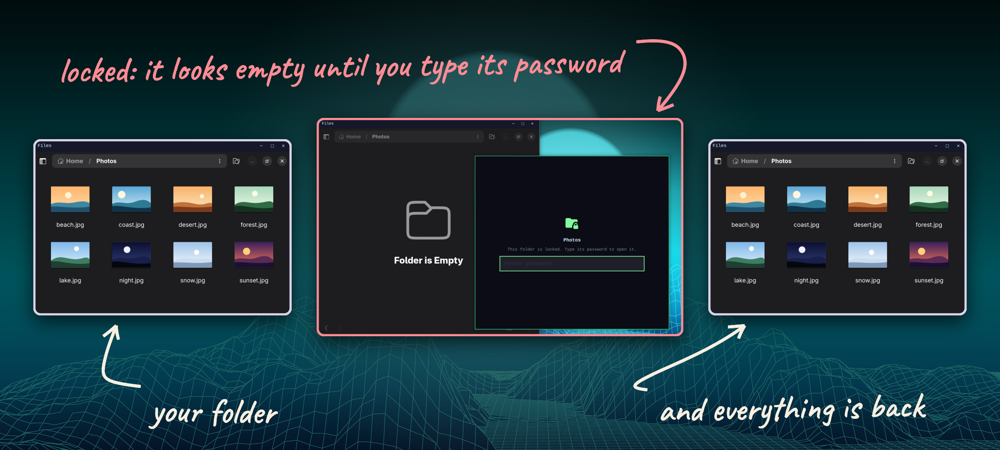
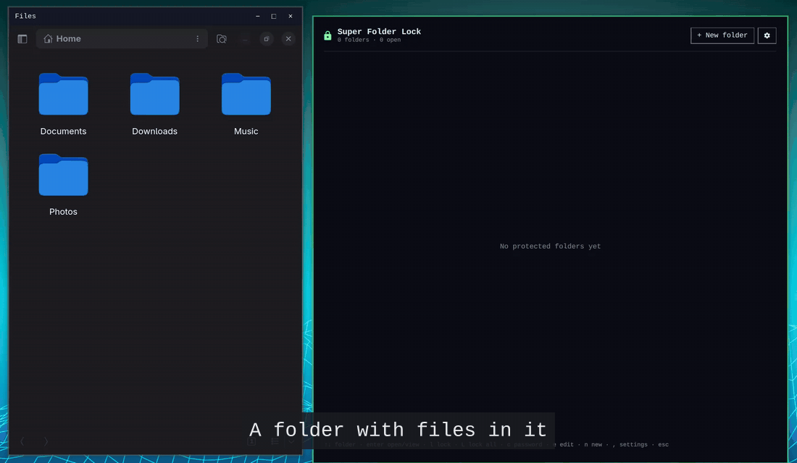
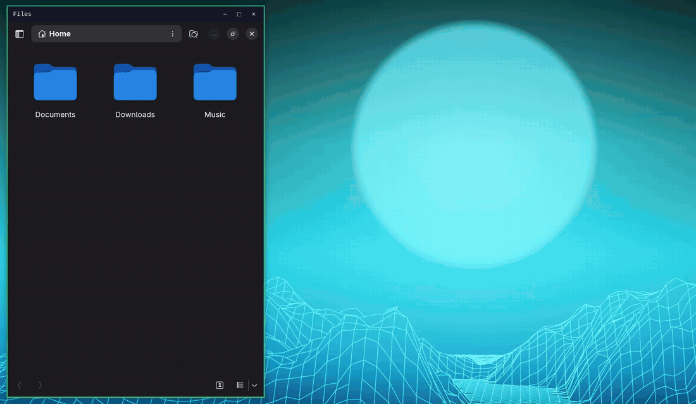
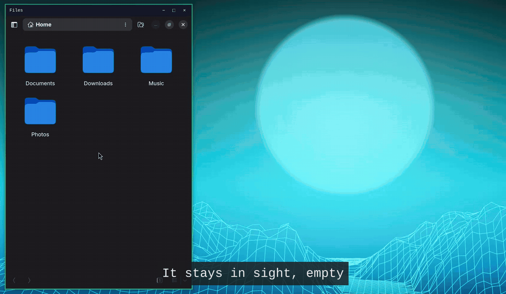
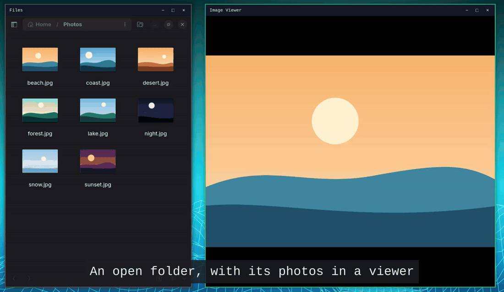
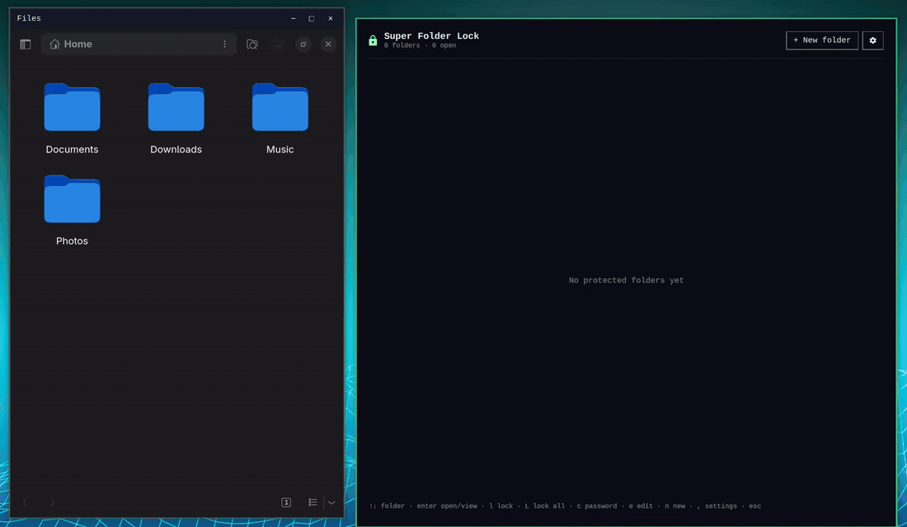
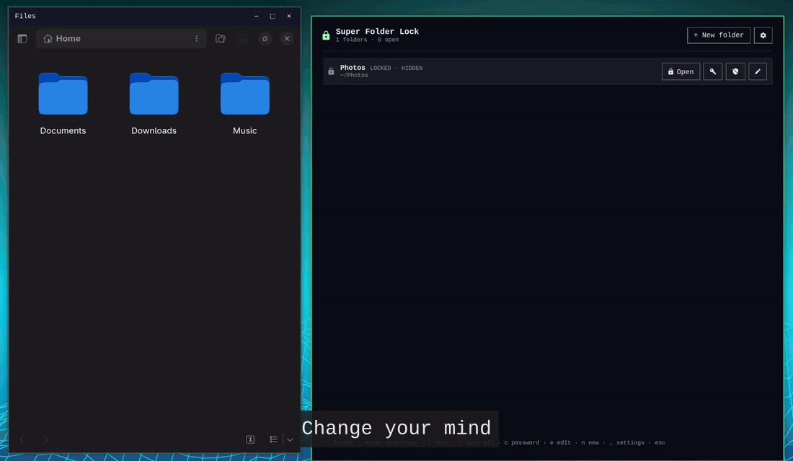
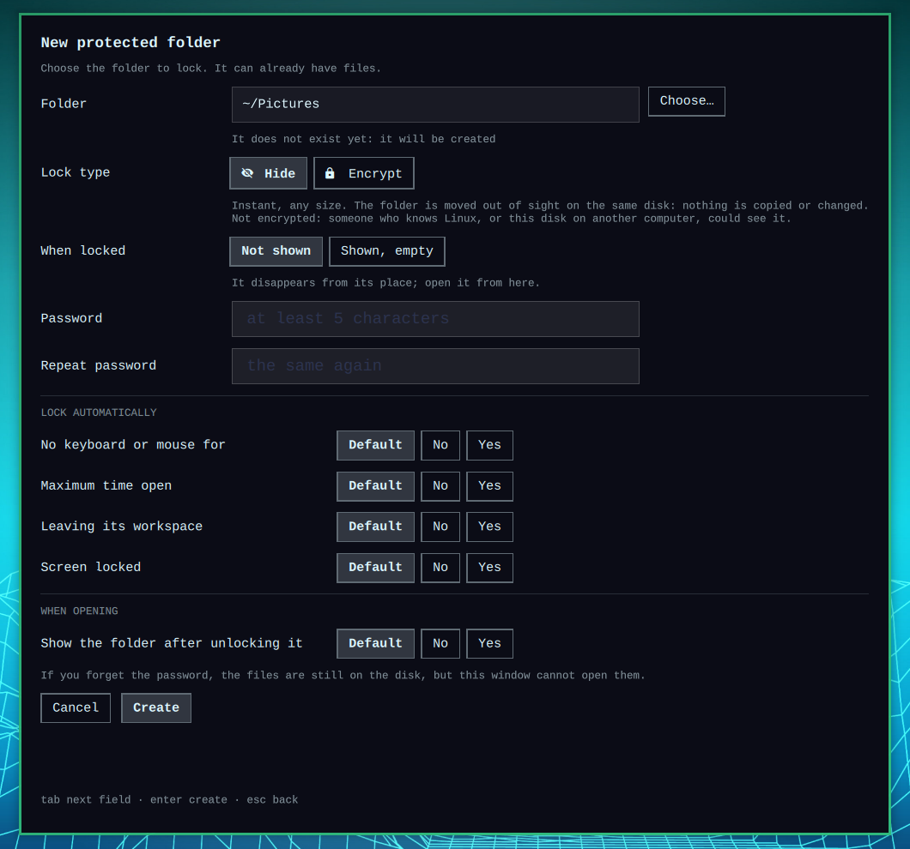
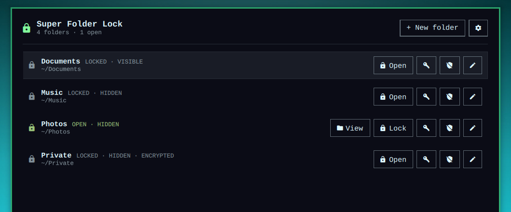
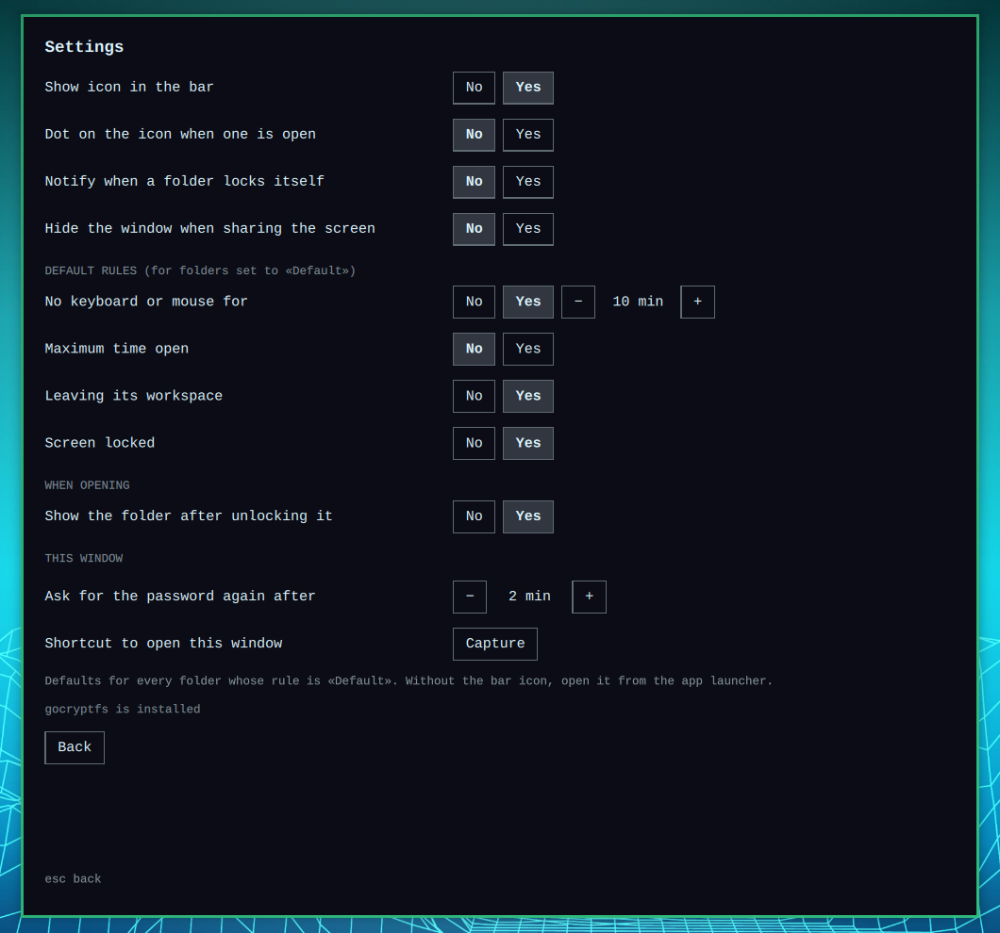

<p align="center"></p>

# Super Folder Lock

Folders with a password for the Omarchy shell. Lock a folder and it leaves its place (or stays there,
empty); type its password to get it back. Walk away, switch workspace or lock the screen, and it locks
again on its own.

**Status: v0.2.0 (beta).** Two lock types (Hide and Encrypt), automatic locking, folders on
external disks, and a window that asks for your system password before it lists anything.

> **Read this first.** *Hide*, the default, keeps a folder away from people using your screen. It is
> **not** encryption. If the files must stay safe even when someone takes the disk, use *Encrypt*.
> See [Known limits](#known-limits).

## See it

**Lock a folder that already has files.** Choose it, type a password, and it is gone from its place.
Nothing is copied: the folder is moved out of sight on the same disk, so it takes the same instant with
ten files or with a hundred thousand.



**Type its password and it is back.** The window asks for your system password before it lists anything;
then each folder opens with its own and, unless you turn that off, shows up in Files with everything in it.



**Or leave it in sight, empty.** A folder set to *Shown, empty* stays in its place with nothing inside.
Double-click it in Files and a small card asks for its password.



**It locks itself.** Leave the workspace, lock the screen or walk away from the keyboard, and the open
folders lock again. Each rule can be changed for one folder or for all of them.



**Encrypt what must stay safe.** For a new or empty folder, *Encrypt* stores what you put inside in a
gocryptfs vault, which only its password opens, on any computer. It hands you a recovery key once.



**Change your mind whenever you want.** The shield button, *Remove protection*, asks for its
password and gives you back a normal folder. Only then does it leave the list: nothing stays locked unseen.



## Two lock types

| | Hide (default) | Encrypt |
|---|---|---|
| How it works | The folder is moved out of sight, on the same disk | A [gocryptfs](https://nuetzlich.net/gocryptfs/) vault |
| Folders that already have files | Yes, any size, instantly | No: only new or empty folders |
| Copies or changes your files | Never | Files are written encrypted as you save them |
| Protects the disk on another computer | **No** | Yes |
| If you forget the password | The files are still on the disk | Use the recovery key, shown once when it is created |
| Needs | Nothing else | `gocryptfs` |

While locked, a folder of either type can be **Not shown** (it disappears from its place) or
**Shown, empty** (it stays there with nothing inside).

<p align="center"></p>

## What it does

<p align="center"></p>

- **Nothing is listed until you prove it is you.** The window asks for your system password (through
  PAM, the same check as Omarchy's lock screen). Until then it loads no names and no paths. It asks
  again after 2 minutes without use, when you close it, and when the screen locks.
- **Every folder has its own password** (5 characters or more). Passwords reach the helper through
  standard input only: never in command arguments, logs or temporary files.
- **Folders lock themselves.** Each rule can be set for all folders and changed per folder:
  - after some time without keyboard or mouse (10 minutes by default);
  - when you leave the workspace where you opened it;
  - when the screen locks;
  - after a maximum time open (off by default), with a button to postpone it 15 minutes.
- **It tells you what is using a folder.** Locking by hand lists the programs that have files open and
  lets you decide.
- **Double-click to open.** A *Shown, empty* folder opened in Files (Nautilus) brings up a small card
  asking for its password.
- **Works on external disks.** A folder on a connected disk stays on that disk.
- **Nothing is deleted.** *Remove protection* puts the files back in a normal folder: *Hide* moves the
  folder back as it was; *Encrypt* copies the files out, compares them byte by byte, and only then
  removes the encryption. If the list itself is lost, *Add back* finds each folder by its password.
- **It cleans up traces.** Locking removes the thumbnails and the recent-files entries of that folder.
- **Everything starts locked.** Whether a folder is open is never saved. The plugin locks every folder
  when it starts, and a small watchdog does it if the shell stops.
- **Discreet.** A neutral, optional bar icon; the open dot and notifications are off by default.
- English and Spanish, following Omarchy's language.

## What it touches

- No root, no network, and nothing is written to `/etc`. Your password is checked with the PAM service
  Omarchy's own lock screen uses.
- It moves or mounts **only the folders you add**. System folders are refused.
- It adds one Hyprland window rule (its own window) and, only if you set one, one shortcut. Both are
  applied while the shell runs; your configuration files are not edited.
- It writes one launcher entry, and its own folders (see [Data](#data)).
- When a folder locks, it removes that folder's entries from the thumbnail cache and from
  `recently-used.xbel`. Nothing else in them changes.
- To tell which programs are using a folder, it reads `/proc` for your own processes.
- While a folder or its window is open, it asks Omarchy every 2 seconds whether the screen is locked.

## Install

```bash
omarchy plugin add https://github.com/LeninZapata/omarchy-super-folder-lock.git --enable
omarchy bar move leninzapata.super-folder-lock --section tray
```

The second line moves the icon to the tray drawer (any other bar section works too). The window also
opens from the app launcher, as **Super Folder Lock**.

For *Encrypt* folders:

```bash
omarchy pkg add gocryptfs
```

### Uninstall

**First use *Remove protection* on every folder**, so your files are back in normal folders. Then:

```bash
omarchy plugin remove leninzapata.super-folder-lock
rm -f ~/.local/share/applications/leninzapata-super-folder-lock.desktop
```

Folders you left locked are not deleted; a reinstall picks them up. Do not erase the data folders
listed under [Data](#data) while a folder is still locked: your files are in there.

### Requirements

Omarchy 4.5 or newer with Hyprland 0.56 (Lua config) and `python3`. *Encrypt* also needs `gocryptfs`.
Double-click to open works with Files (Nautilus).

## First folder

1. Open the window and type your system password.
2. Press <kbd>n</kbd> or **New folder**, and choose a folder (or type the path of a new one).
3. Pick the lock type, how it looks when locked, and a password.
4. With *Encrypt*, save the recovery key: it is shown only once and stored nowhere.

**Keys:** <kbd>↑</kbd> <kbd>↓</kbd> choose a folder · <kbd>Enter</kbd> open or view · <kbd>l</kbd> lock ·
<kbd>L</kbd> lock all · <kbd>n</kbd> new · <kbd>e</kbd> edit · <kbd>c</kbd> password · <kbd>,</kbd> settings ·
<kbd>Esc</kbd> back.

## Settings

The rules apply to every folder left on **Default**:

<p align="center"></p>

| Setting | Default | |
|---|---|---|
| No keyboard or mouse for | On, 10 min | 1 min – 2 h |
| Maximum time open | Off | 5 min – 24 h |
| Leaving its workspace | On | |
| Screen locked | On | |
| Show the folder after unlocking it | On | off: it unlocks, and the window stays open |
| Ask for the password again after | 2 min | 30 s – 1 h |
| Shortcut to open this window | None | press the keys; one already in use is never taken over |
| Show icon in the bar | On | |
| Dot on the icon when one is open | Off | |
| Notify when a folder locks itself | Off | |
| Hide the window when sharing the screen | Off | also hides it from screenshots |

## Data

| Path | What |
|---|---|
| `~/.config/omarchy/super-folder-lock/settings.json` | settings, without names or paths |
| `~/.local/share/omarchy/super-folder-lock/folders.sfldb` | the list of folders and their rules |
| `~/.local/share/omarchy/super-folder-lock/locked/` | **your files**: the *Hide* folders that are locked |
| `~/.local/share/omarchy/super-folder-lock/vaults/` | **your files**: the encrypted data of *Encrypt* folders |
| `<disk>/.super-folder-lock/` | the same, for folders on an external disk |
| `~/.local/share/applications/leninzapata-super-folder-lock.desktop` | the launcher entry |

The plugin's folders are owner-only (`700`, files `600`), enforced at every start, on disks that keep
permissions. A *Hide* password is kept only as a scrypt hash; an *Encrypt* password is never stored.

### If the plugin stops working

Your files do not depend on the plugin. `<id>` is the folder name you find inside `vaults/` or `locked/`.

```bash
# Encrypt: mount it with its password (add -masterkey=stdin to use the recovery key)
mkdir -p ~/rescue && gocryptfs ~/.local/share/omarchy/super-folder-lock/vaults/<id> ~/rescue

# Hide: move it back
cd ~/.local/share/omarchy/super-folder-lock/locked
chmod 700 <id> && mv <id>/data ~/rescued-folder
```

## Known limits

- **Hide is not encryption.** Someone who knows Linux and has your session open, or your disk on another
  computer, can reach the files (the commands are right above). It protects from people looking
  around, not from an attacker.
- **An open folder is open.** While it is unlocked, any program of your account can read it.
- **A file already open when the folder locks** can still be read by the program that opened it.
- **With Encrypt, losing the password and the recovery key means losing the files.** Nobody can recover
  them. With Hide there is no password recovery in the window.
- **Moving files into an Encrypt folder** does not wipe the originals: on an SSD or on btrfs, what you
  delete may stay on the disk (or in a snapshot) for a while.
- While it is open, an encrypted folder shows up as a volume in the Files sidebar.
- A folder cannot move to another disk by locking it, since that would be copying it.
- Lock a folder on an external disk before unplugging it.
- Wrong system passwords count for `faillock`, the same as on the lock screen: 10 in a row block it,
  and `sudo`, for 120 seconds.

## Scripting

```bash
omarchy-shell leninzapata.super-folder-lock open      # open the window (it still asks for the password)
omarchy-shell leninzapata.super-folder-lock lockAll   # lock every open folder
omarchy-shell leninzapata.super-folder-lock status    # JSON: how many are open; never names or paths
```

## Development

```
├── manifest.json         # plugin manifest: a service and a bar widget
├── Service.qml           # state, helper queue, password gate, automatic locking, IPC
├── VaultWindow.qml       # the window: list, settings, password change, card
├── GateView.qml          # the system password screen
├── FolderForm.qml        # new folder, edit, add back
├── FolderRow.qml         # one folder of the list
├── PasswordField.qml     # the plugin's own password field (no native Qt input)
├── PlainEdit.qml         # the plugin's own text field
├── Auth.qml              # PAM and faillock
├── BarWidget.qml         # the bar icon
├── Core.js               # pure locking rules
├── Settings.js           # defaults and validation of settings.json
├── Editing.js            # text editing logic of the fields
├── Shortcut.js           # the shortcut sent to Hyprland
├── Watchdog.js           # locks everything if the shell stops
├── bin/folderlock.py     # the helper: the only one that writes the list and moves or mounts folders
├── bin/visiblewatch.py   # notices a double-click on a locked, shown folder
├── bin/binds.py          # releases the shortcut, only where it is the plugin's
├── i18n/                 # en.json, es.json
└── tests/                # python and node tests, in a sandbox with its own home
```

Tests: `tests/run.sh`; after editing, `omarchy restart shell`. [Changelog](changelog.md).

## License
[MIT](LICENSE)
